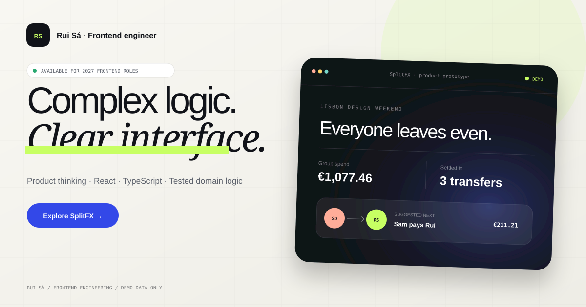
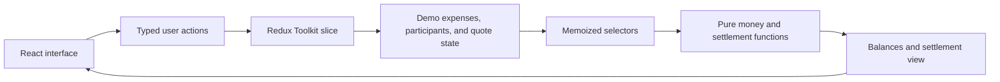

# SplitFX

**A cross-currency group expense and settlement prototype built to make money movement explainable.**



[Open the live prototype](https://ruimiguelyo.github.io/splitfx/) · [Browse the source](https://github.com/ruimiguelyo/splitfx) · [CI status](https://github.com/ruimiguelyo/splitfx/actions/workflows/ci.yml)

SplitFX is a frontend product-engineering portfolio project by [Rui Sá](https://github.com/ruimiguelyo). It explores a deceptively difficult problem: when a group spends in different currencies, how can the interface show who owes whom without hiding quote freshness, rounding, or the assumptions behind the result?

This is a client-side prototype with demo data. It does **not** connect to a bank, move real money, authenticate users, or fetch live foreign-exchange rates.

## Why this project exists

Most expense-splitting demos stop at arithmetic. SplitFX treats the calculation and the interface as one trust problem:

- Money is represented as integer minor units rather than binary floating-point totals.
- Currency conversion rounds once, at the target-currency boundary.
- Quote freshness is visible through explicit live, loading, expired, offline, and error states.
- Settlement output is deterministic and described accurately as using fewer transfers, not as a globally minimal solution.
- Balances and settlement suggestions are derived from source data instead of stored as competing state.

The result is intentionally small enough to review, but deep enough to discuss product decisions, state modelling, numerical correctness, accessibility, and testing.

## Review it in five minutes

1. Start the app and inspect the preloaded multi-currency group.
2. Add an expense and observe the derived balances and settlement plan update.
3. Explore the quote-status controls, including expired and offline behaviour.
4. Read the focused domain logic in [`src/domain`](src/domain) and its tests.
5. Use the [recruiter walkthrough](docs/RECRUITER_WALKTHROUGH.md) for a guided tour.

## Run locally

### Requirements

- Node.js 22 or newer
- npm

```bash
npm install
npm run dev
```

Open `http://127.0.0.1:3000`.

To run the complete local quality gate:

```bash
npm run verify
npm run test:e2e
```

`npm run verify` checks formatting, linting, strict TypeScript, coverage-enforced tests, and the production build. End-to-end tests are separate so that the fast feedback loop remains useful during development.

## Product behaviour

SplitFX starts with a fictional Lisbon weekend and entirely fictional participants and expenses. The prototype supports a deliberately bounded flow:

- Review expenses recorded in EUR, GBP, and USD.
- Add an expense with a payer, category, and selected participants.
- Recalculate per-person balances in the group's EUR base currency.
- Produce a compact, deterministic settlement suggestion.
- Surface the state and validity window of the demo FX quote.
- Reset the experience back to known demo data.

For the product assumptions, user stories, exclusions, and possible next steps, see the [product brief](docs/PRODUCT_BRIEF.md).

## Engineering highlights

### Money and rounding

```ts
interface Money {
  readonly minor: number;
  readonly currency: 'EUR' | 'GBP' | 'USD';
}
```

Amounts such as €12.34 enter the domain as `1234` minor units. An expense is converted to the base currency before it is divided, with any indivisible remainder assigned deterministically. This makes the conservation rule inspectable: allocated shares add back to the converted expense total.

### State and derivation



The store owns inputs and lifecycle state. Selectors call pure domain functions to calculate totals, balances, and settlements. That separation keeps React components focused on interaction and presentation, while the numerical rules remain easy to test without a browser.

### Quote lifecycle

The quote refresh is a controlled simulation over fixed demo rates. It models the UI states a production integration would need, but it is not presented as market data. The explicit validity timestamp allows the interface to distinguish a usable quote from an expired one rather than silently continuing with stale values.

### Quality strategy

- **Jest** exercises money, settlement, state, and component behaviour.
- **Testing Library** validates behaviour through user-visible semantics.
- **Cypress** covers the critical browser journey.
- **TypeScript strict mode** includes unchecked-index and exact-optional-property checks.
- **ESLint** includes React Hooks and JSX accessibility rules.
- **CI** runs the quality gates for pushes and pull requests.

The detailed test matrix and manual accessibility checks are documented in [Testing and accessibility](docs/TESTING_AND_ACCESSIBILITY.md).

## Technology

| Concern              | Choice                      | Reason                                                                  |
| -------------------- | --------------------------- | ----------------------------------------------------------------------- |
| Interface            | React                       | Component-driven interaction and clear UI composition                   |
| Language             | TypeScript                  | Explicit domain contracts and strict compile-time checks                |
| State                | Redux Toolkit + React Redux | Predictable transitions and memoized derived data                       |
| Build                | Webpack                     | Direct control over the production and development pipeline             |
| Unit/component tests | Jest + Testing Library      | Fast behavioural feedback around domain and UI boundaries               |
| Browser tests        | Cypress                     | Confidence in the main journey as a user experiences it                 |
| Styling              | CSS                         | A small, inspectable visual system without runtime styling dependencies |

## Repository map

```text
src/
├── app/                 Store and typed Redux hooks
├── components/          Reusable interface components
├── content/             Candidate profile content
├── domain/              Money conversion and settlement rules
├── features/splitfx/    Feature state, selectors, demo data, and UI
└── test/                Shared test setup
cypress/                 End-to-end browser scenarios
docs/                    Product, architecture, quality, and review notes
.github/                 CI, Pages deployment, and contribution templates
```

## Deliberate limits

- The application is a portfolio prototype, not a financial product.
- Rates and refresh latency are simulated; there is no FX provider.
- There is no backend, persistence, authentication, authorisation, or payment rail.
- Supported currencies are limited to EUR, GBP, and USD, each with two fraction digits in this prototype.
- The greedy settlement routine is deterministic and compact, but no global-minimum claim is made.
- Automated accessibility checks reduce regressions but do not replace manual keyboard and assistive-technology testing.

These boundaries are part of the design: they keep the review focused on frontend product judgement and make future production requirements visible rather than implied.

## Documentation

- [Product brief](docs/PRODUCT_BRIEF.md)
- [Architecture and decision records](docs/architecture/README.md)
- [Testing and accessibility](docs/TESTING_AND_ACCESSIBILITY.md)
- [Recruiter walkthrough](docs/RECRUITER_WALKTHROUGH.md)

## About Rui

Rui Sá is a frontend developer in Setúbal, Portugal. He worked at Deloitte from October 2021 to March 2026 and is completing a BSc in Computer Engineering at the Polytechnic Institute of Setúbal, expected in 2027. He previously completed a CTeSP in Software Engineering (2021–2023).

- [GitHub](https://github.com/ruimiguelyo)
- [LinkedIn](https://www.linkedin.com/in/rui-s%C3%A1-1243162ab/)

## Licence

This project is available under the [MIT License](LICENSE).
