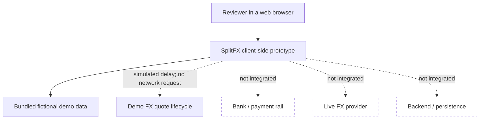
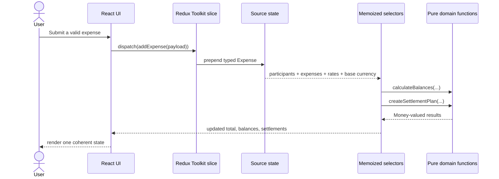
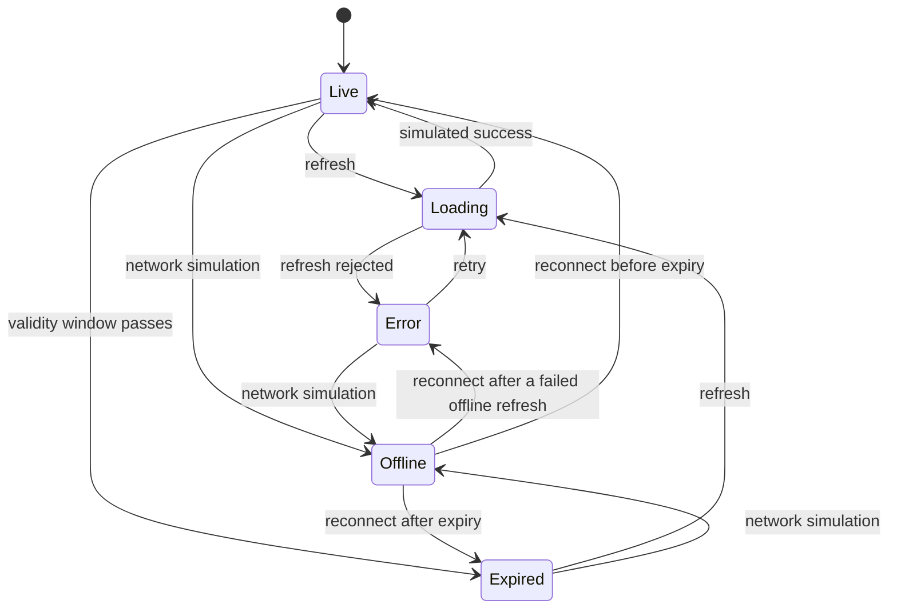

# Architecture

## Purpose

SplitFX is organised to keep product interaction, application state, and financial rules independently understandable. The architecture is intentionally modest: a client-side portfolio prototype does not need service boundaries that it does not have, but its consequential calculations should still have clear contracts.

## System context

The dashed boundaries are important. The prototype models frontend behaviour that a real integration would require, but none of those external systems exists in this repository.

## Internal layers

| Layer                     | Location                                          | Responsibility                                                            |
| ------------------------- | ------------------------------------------------- | ------------------------------------------------------------------------- |
| Entry and app composition | `src/index.tsx`, `src/app`                        | Mount React, provide the store, expose typed hooks                        |
| Feature interface         | `src/features/splitfx` and `src/components`       | Render state, capture intent, dispatch actions                            |
| Application state         | `src/features/splitfx/splitFxSlice.ts`            | Own participants, expenses, rates, and quote lifecycle                    |
| Derived view model        | `src/features/splitfx/selectors.ts`               | Memoize totals, balances, participant lookup, and settlements             |
| Domain                    | `src/domain`                                      | Represent money, convert currency, split costs, and construct settlements |
| Demo content              | `src/features/splitfx/demoData.ts`, `src/content` | Supply fictional product data and public candidate copy                   |

Dependencies point inward toward domain contracts. Domain modules do not import React or Redux.

## Data flow

The add action stores the expense, not every result affected by it. This avoids synchronisation logic between expenses, totals, balances, and settlements.

## Sources of truth

| Data                         | Stored or derived? | Reason                                                       |
| ---------------------------- | ------------------ | ------------------------------------------------------------ |
| Group name and base currency | Stored             | Inputs to product and calculation context                    |
| Participants and expenses    | Stored             | User-visible source records                                  |
| Rates and quote timestamps   | Stored             | Inputs with an explicit lifecycle                            |
| Network/request/error state  | Stored             | Async interaction state                                      |
| Trip total                   | Derived            | Function of expenses, base currency, and rates               |
| Participant balances         | Derived            | Function of participants, expenses, base currency, and rates |
| Settlement suggestions       | Derived            | Function of current balances                                 |
| Quote health label           | Derived            | Precedence over network, request, error, and expiry values   |

## Quote state model

This diagram describes the user-facing health model. The store represents it using orthogonal network, request, error, and timestamp fields, and the selector applies a documented precedence.

## Financial invariants

The implementation is designed around these inspectable invariants:

1. A `Money` value carries both an integer minor-unit amount and its currency.
2. Rates have one direction: units of each supported currency for one EUR.
3. A cross-currency amount is rounded once when it enters the target currency.
4. The shares allocated for an expense add back to its converted total exactly.
5. Participant balances add to zero for a valid group ledger.
6. Settlement output never transfers more than the remaining debtor/creditor position.
7. The same balances produce the same ordered settlement output.

These are prototype-domain guarantees, not statements about real market prices or executed payments.

## Runtime and build

Webpack provides the development server and production bundle. TypeScript is compiled through Babel for the bundle while `tsc --noEmit` performs strict type checking as a separate quality gate. This separation keeps the development/build pipeline explicit and prevents a successful transpile from being mistaken for a successful type check.

The production bundle is static and suitable for GitHub Pages. There is no server runtime and no secret configuration.

## Extension seams

If the prototype were expanded, useful seams would include:

- A quote adapter returning rates, provider attribution, fees/spread semantics, timestamps, and expiry.
- A currency metadata module supporting fraction digits and locale rules beyond the three demo currencies.
- An authenticated repository/API boundary for groups and expenses.
- Explicit split-strategy types for equal, exact, percentage, and itemised allocation.
- A settlement execution capability separated from settlement suggestion and protected by recipient verification and confirmation.

Introducing these seams now would add abstractions without an integration to validate them, so the current prototype documents them instead.

## Decision records

| ADR                                               | Status   | Decision                                                               |
| ------------------------------------------------- | -------- | ---------------------------------------------------------------------- |
| [0001](adr/0001-money-in-minor-units.md)          | Accepted | Represent supported money as safe integer minor units                  |
| [0002](adr/0002-explicit-fx-quote-lifecycle.md)   | Accepted | Model quote freshness and failure explicitly over demo rates           |
| [0003](adr/0003-deterministic-settlement-plan.md) | Accepted | Use deterministic greedy debtor/creditor matching with a limited claim |
| [0004](adr/0004-derived-financial-state.md)       | Accepted | Store source state and derive financial views through selectors        |

“Accepted” means accepted for this prototype. A production system would revisit each record against its regulatory, data, integration, and scale requirements.
